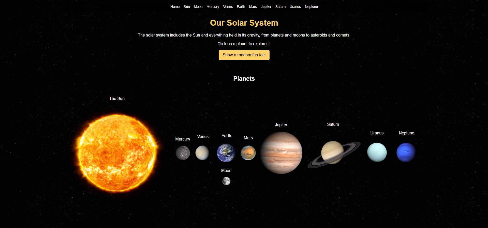

# Solar System

**Course:** CSCI 39548  
**Semester:** Fall 2026  
**Project:** Project 1 – Solar System Website  
**Due Date:** Novemeber 5, 2026 

## 📖 About the Project

This project is a 10 page website exploring the Solar System. Each page focuses on a different celestial body. The goal is to create a unique experience for each page using planet themed designs, interesting facts, images, and JavaScript interactivity.

The website is built using only HTML, CSS, and JavaScript, without any additional frameworks or libraries.



## 🪐 Website Pages


| Page | Description | Completed |
|---|---|---|
| Homepage | Introduction to the Solar System | ✅ |
| Sun | Information about the Sun | ✅ |
| Moon | Information about Earth's Moon | ✅ |
| Earth | Information about Earth | ✅ |
| Mercury | Information about Mercury | ✅ |
| Venus | Information about Venus | ✅ |
| Mars | Information about Mars | ✅ |
| Jupiter | Information about Jupiter | ✅ |
| Saturn | Information about Saturn | ✅ |
| Uranus | Information about Uranus | ✅ |
| Neptune | Information about Neptune | ✅ |

## 🛠️ Technologies Used

- HTML5
- CSS3
- JavaScript (Vanilla JS)

**Note:** No external frameworks or JavaScript libraries are used.

---

# ✅ Project Requirements Checklist

Use this checklist to track your progress against the official project rubric.

## 1. Pages & Content — 15 Points

- [x] All 10 required pages are present.
- [x] Every page has its own heading/title.
- [x] Every celestial body page includes at least 5 accurate facts.
- [x] Facts include relevant information such as size, distance from the Sun, temperature, day length, year length, or number of moons.
- [x] Homepage has its own title.
- [x] Homepage includes a short introduction to the Solar System.

## 2. Navigation — 10 Points

- [x] Every page includes a navigation bar.
- [x] Navigation links to all 10 pages.
- [x] All navigation links work correctly.
- [x] Navigation is consistent across all pages.
- [x] No broken links or missing pages.

## 3. JavaScript Interactivity — 20 Points

- [ ] Homepage has a working JavaScript feature.
- [ ] Sun page has a working JavaScript feature.
- [ ] Moon page has a working JavaScript feature.
- [ ] Earth page has a working JavaScript feature.
- [ ] Mercury page has a working JavaScript feature.
- [ ] Venus page has a working JavaScript feature.
- [ ] Mars page has a working JavaScript feature.
- [ ] Jupiter page has a working JavaScript feature.
- [ ] Saturn page has a working JavaScript feature.
- [ ] Uranus page has a working JavaScript feature.
- [ ] Each page uses a different or sufficiently varied JavaScript feature.
- [ ] All buttons and interactive elements work as intended.

## 4. Planet-Themed Styling — 15 Points

- [x] Homepage has its own space-themed design.
- [x] Sun page has a design matching the Sun.
- [x] Moon page has a design matching the Moon.
- [x] All planet pages have a design matching their respetive planet.
- [x] Colors, backgrounds, fonts, and effects match each celestial body.
- [x] Text remains readable against the backgrounds.

## 5. Images — 10 Points

- [x] Homepage includes at least 2 relevant images.
- [x] Sun page includes at least 2 relevant images.
- [x] Moon page includes at least 2 relevant images.
- [x] Every planet page includes at least 2 relevant images.
- [x] Every image has descriptive alt text.
- [x] Images are properly sized and displayed.
- [x] No broken image links.

## 6. Code Quality — 10 Points

- [x] Only HTML, CSS, and JavaScript are used.
- [x] No additional frameworks or libraries are used.
- [x] HTML is properly structured and indented.
- [x] CSS is organized and readable.
- [x] JavaScript is organized and readable.
- [ ] Code includes helpful comments where appropriate.
- [x] Files and folders are properly organized.
- [x] No unnecessary or unused code remains.

## 7. Video Walkthrough — 20 Points

- [ ] Video is at least 5 minutes long.
- [ ] Video includes clear voice-over narration.
- [ ] Homepage is demonstrated.
- [ ] Sun page is demonstrated.
- [ ] Moon page is demonstrated.
- [ ] Earth page is demonstrated.
- [ ] Mercury page is demonstrated.
- [ ] Venus page is demonstrated.
- [ ] Mars page is demonstrated.
- [ ] Jupiter page is demonstrated.
- [ ] Saturn page is demonstrated.
- [ ] Uranus page is demonstrated.
- [ ] JavaScript feature on every page is demonstrated.
- [ ] Website navigation is explained.
- [ ] CSS and planet-themed styling are explained.
- [ ] JavaScript implementation is explained.
- [ ] Source code is shown during the walkthrough.
- [ ] Audio is clear and understandable.

---

# 🚀 Running the Project

1. Clone the repository:

```bash
git clone YOUR_GITHUB_REPOSITORY_URL
```

2. Open the project folder.
3. Open `index.html` in your browser.

# 🎥 Project Video

**Video Walkthrough:** [Add video link here]

---

**Course:** CSCI 39548 – Fall 2026

Project Requirements: https://docs.google.com/document/d/e/2PACX-1vQyP1rfE96kj6Yjarsdci1_wgahQyeBD8tfv9Nmh47M9qzibVpNFGzBD0RAUdzFmN3rEj5btqEW38mk/pub